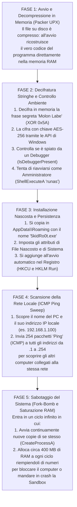

# Relazione Tecnica di Tirocinio: Analisi Comportamentale e Superamento delle Tecniche Anti-VM / Anti-Sandbox del Malware `Astaroth.exe` tramite Qiling Framework

**Attività di Tirocinio – Sicurezza Informatica e Malware Analysis**  
**Oggetto:** Studio del ciclo di vita operativo di un malware multi-funzione (Persistenza, Network Discovery e Denial of Service) e neutralizzazione dei meccanismi di evasione e anti-analisi mediante emulazione dinamica  
**Campione Analizzato:** [`Astaroth.exe`](file:///home/alberto-mancini/Documenti/Tirocinio/qiling/rootfs/x8664_windows/Windows/Documenti/Source/Astaroth/Astaroth.exe) (Eseguibile Windows PE32 a 32 bit, compilato in C con MinGW GCC 13 e compresso con packer UPX 4.22)  
**Strumento di Analisi:** Qiling Framework (Emulatore binario controllato tramite lo script Python [`Astaroth.py`](file:///home/alberto-mancini/Documenti/Tirocinio/qiling/rootfs/x8664_windows/Windows/Documenti/Astaroth.py))

---

## Introduzione e Metodologia di Analisi

La presente relazione descrive il percorso di indagine svolto sul campione malevolo [`Astaroth.exe`](file:///home/alberto-mancini/Documenti/Tirocinio/qiling/rootfs/x8664_windows/Windows/Documenti/Source/Astaroth/Astaroth.exe), un eseguibile per sistemi Windows che, durante i primi tentativi di esecuzione standard, causava il blocco immediato dell'ambiente di emulazione impedendo di comprenderne la natura.

Per analizzare un programma sospetto senza correre il rischio di infettare un computer reale, i ricercatori utilizzano solitamente due approcci:
1. **L'analisi statica**, che consiste nell'esaminare il file "a motore spento" (senza avviarlo), leggendone il codice interno con appositi programmi chiamati disassemblatori.
2. **L'analisi dinamica**, che consiste nell'avviare il malware all'interno di un ambiente protetto (una *Sandbox* o un *Emulatore*) per osservare cosa fa in tempo reale.

In questo lavoro abbiamo adottato un approccio di **emulazione dinamica avanzata** basato su **Qiling Framework**. A differenza di una macchina virtuale tradizionale (in cui è presente un intero sistema operativo Windows installato), Qiling è un emulatore leggero governato da uno script Python ([`Astaroth.py`](file:///home/alberto-mancini/Documenti/Tirocinio/qiling/rootfs/x8664_windows/Windows/Documenti/Astaroth.py)) che simula il processore e la memoria del computer. Ogni volta che il malware cerca di interagire con il sistema operativo Windows — ad esempio per cifrare dei dati, copiare un file, modificare il Registro di sistema o inviare pacchetti in rete — lo script Python intercetta la richiesta tramite degli appositi "ganci" software (detti **hook**), registra l'azione malevola e restituisce al programma una risposta simulata che lo induce a proseguire ignaro di essere osservato.

Grazie a questa metodologia è stato possibile capire perché i precedenti tentativi di analisi fallivano, neutralizzare tutte le trappole **Anti-VM, Anti-Emulatore e Anti-Sandbox** integrate nel codice e portare a compimento l'emulazione del malware dall'inizio alla fine.

---

## 1. Comportamento Generale del Malware: Cosa Fa

Una volta rimosso lo strato di compressione iniziale che ne nasconde il contenuto, l'analisi ha rivelato che `Astaroth.exe` è un malware progettato per **installarsi stabilmente nel computer della vittima, mappare tutti gli altri dispositivi presenti nella stessa rete locale (casa o ufficio) e infine scatenare un attacco di sabotaggio (Denial of Service)** che esaurisce la memoria RAM e moltiplica i processi fino a paralizzare il sistema.

Il comportamento del malware si articola in **cinque fasi consecutive**, riassunte nello schema seguente:



1. **Fase 1 – Decompressione Automatica in RAM:** Quando si fa doppio clic su `Astaroth.exe`, il programma che parte non è ancora il vero malware, ma un "involucro" compresso con lo strumento **UPX**. Questo involucro estrae in memoria RAM il vero codice malevolo e poi gli cede il comando.
2. **Fase 2 – Operazioni Crittografiche, Controllo Anti-Spia e Richiesta Permessi:** Il malware ricostruisce in memoria una stringa nascosta (`"Molon Labe"`, celebre motto spartano usato dall'autore come firma) e la cifra usando l'algoritmo **AES-256**. Subito dopo controlla se c'è un analista che lo sta osservando tramite un debugger e prova a rilanciarsi chiedendo i massimi privilegi di **Amministratore** (`runas`).
3. **Fase 3 – Infezione del Sistema e Persistenza:** Per assicurarsi di rimanere nel computer anche se l'utente cancella il file scaricato o spegne il PC, il malware crea una copia di se stesso dentro la cartella di sistema `AppData\Roaming` rinominandosi in **`5kidRo0t.exe`**. Rende poi questo file invisibile in Esplora File e registra la voce `5kidRo0t` nel Registro di Windows affinché il virus venga eseguito automaticamente a ogni accensione.
4. **Fase 4 – Mappatura della Rete Locale (Network Discovery):** Il malware individua l'indirizzo IP del computer infetto (ad esempio `192.168.1.100`) e contatta in sequenza tutti i 254 indirizzi possibili della stessa sottorete (`192.168.1.1`, `192.168.1.2`, ..., `192.168.1.254`) inviando a ciascuno un messaggio di controllo (**Ping ICMP**) per sondare la rete locale.
5. **Fase 5 – Attacco Distruttivo alle Risorse (Fork-Bomb + RAM Exhaustion):** Nell'ultima fase il malware entra in un ciclo senza fine in cui duplica continuamente se stesso e sottrae blocchi di **circa 400 Megabyte di memoria RAM** alla volta, riempiendoli forzatamente fino a causare il congelamento totale del computer o il crash della macchina virtuale di analisi.

---

## 2. Tecniche Anti-VM, Anti-Sandbox e di Evasione: Individuazione e Bypass

La parte più rilevante del lavoro di tirocinio ha riguardato l'identificazione e il superamento degli ostacoli progettati dall'autore del malware per impedire l'analisi statica e mandare fuori strada le sandbox e gli emulatori.  
Di seguito vengono esaminate nel dettaglio le **sei tecniche principali** individuate, spiegando in modo discorsivo il loro funzionamento, come sono state scoperte e come sono state neutralizzate nello script [`Astaroth.py`](file:///home/alberto-mancini/Documenti/Tirocinio/qiling/rootfs/x8664_windows/Windows/Documenti/Astaroth.py).

---

### 2.1 Compressione ed Offuscamento dell'Eseguibile tramite Packer UPX (`UPX 4.22`)

#### Come funziona e perché ostacola l'analisi
Se si prova ad aprire `Astaroth.exe` con un normale programma di analisi statica per leggere le parole di testo contenute al suo interno o la lista delle funzioni di Windows che utilizza, non si trova quasi nulla di significativo. L'autore ha infatti compresso l'intero eseguibile con un *packer* chiamato **UPX (Ultimate Packer for eXecutables)**.  
Un packer funziona esattamente come una scatola chiusa e sigillata: finché il file è fermo sul disco, il vero codice del malware è compresso e illeggibile. Solo quando il programma viene avviato, una piccola routine iniziale (detta *stub di decompressione*, situata all'indirizzo `0x00413360`) apre la scatola e ricostruisce il vero programma direttamente nella memoria RAM.

#### Come è stata individuata
Analizzando l'intestazione del file eseguibile, le sezioni interne non avevano i nomi standard dei programmi Windows (`.text`, `.data`, `.rdata`), bensì si chiamavano **`UPX0`**, **`UPX1`** e **`UPX2`**, e la tabella delle funzioni importate mostrava appena 7 funzioni generiche usate dal packer per aprire il programma in memoria.

#### Come è stata aggirata in Python
Invece di cercare di decomprimere il file manualmente all'esterno, abbiamo sfruttato la capacità di Qiling di eseguire il codice del processore: abbiamo lasciato che il malware partisse dall'indirizzo iniziale del packer (`0x00413360`) in modo che **fosse il malware stesso a decomprimersi da solo in memoria**.  
Abbiamo poi posizionato un "gancio" (*hook*) esattamente all'inizio della funzione principale del programma decompattato (`main`, all'indirizzo `0x00401a18`): appena il packer finisce il suo lavoro e passa il controllo al vero malware, il nostro script Python scatta una "fotografia" della memoria RAM e la salva su disco nel file [`astaroth_unpacked_dump.bin`](file:///home/alberto-mancini/Documenti/Tirocinio/qiling/rootfs/x8664_windows/Windows/Documenti/astaroth_unpacked_dump.bin), rendendo finalmente visibile tutto il codice interno.

```python
def hook_unpacked_main(ql):
    """
    Intercetta il momento esatto in cui il packer UPX termina la decompressione
    e salta alla funzione main() del vero malware (indirizzo 0x00401a18).
    """
    print("\n[+] Decompattamento UPX completato! Raggiunto main() a 0x00401a18.")
    dump_path = "astaroth_unpacked_dump.bin"
    # Leggiamo l'intera immagine decompattata dalla memoria RAM simulata (da 0x400000)
    mem = ql.mem.read(0x400000, 0x15000)
    with open(dump_path, "wb") as f:
        f.write(mem)
    print(f"[+] Dump della memoria PE decompattata salvato in: {dump_path}")

# Registrazione dell'hook sull'indirizzo della funzione main()
ql.hook_address(hook_unpacked_main, 0x00401a18)
```

#### Output ottenuto
```text
[*] Esecuzione avvio dallo stub UPX (Entry Point: 0x00413360)...

[+] Decompattamento UPX completato! Raggiunto main() a 0x00401a18.
[+] Dump della memoria PE decompattata salvato in: .../astaroth_unpacked_dump.bin
```

---

### 2.2 Offuscamento Stringhe via XOR e Crash degli Emulatori tramite CryptoAPI (`AES-256`)

#### Come funziona e perché è una tecnica Anti-Analisi e Anti-Emulatore
Appena entrato nella funzione `main()`, il malware compie due operazioni:
1. Costruisce in memoria una sequenza di byte apparentemente privi di senso (`17 35 36 35 34 7a 16 3b 3b 38 3f`) e applica a ciascun byte un'operazione matematica di **XOR con la chiave `0x5A`**. In questo modo la stringa segreta **`"Molon Labe"`** non compare mai in chiaro nemmeno dopo aver rimosso il packer UPX, ma viene generata solo per pochi istanti nella memoria temporanea (lo *stack*).
2. Subito dopo, richiede a Windows di cifrare quella stringa con l'algoritmo **AES a 256 bit**, chiamando una serie di cinque funzioni avanzate della libreria di crittografia di Windows (`CryptAcquireContextA`, `CryptGenKey`, `CryptEncrypt`, `CryptDestroyKey`, `CryptReleaseContext`).

Questa seconda operazione agisce di fatto come una **trappola Anti-Emulatore**: gli emulatori come Qiling simulano le funzioni principali di Windows, ma non implementano internamente l'intero motore crittografico `CRYPTSP.dll` di Microsoft. Quando il malware chiamava `CryptAcquireContextA`, Qiling non sapeva come gestirla, provava a eseguire il codice grezzo delle librerie di sistema e **andava in crash immediato** (`Invalid memory fetch` all'indirizzo `0x00012c1e`), facendo fallire l'analisi prima ancora che il malware iniziasse le sue vere attività.

#### Come è stata individuata
Avviando la prima versione di prova dello script con i log dettagliati di Qiling attivi, abbiamo osservato l'avviso `[!] api CryptAcquireContextA (advapi32) is not implemented`, seguito dal caricamento di `cryptsp.dll` e dal blocco immediato dell'emulazione. Esaminando poi il codice disassemblato del `main()` estratto al punto precedente, abbiamo individuato il ciclo XOR che preparava il testo passato a `CryptEncrypt`.

#### Come è stata aggirata in Python
Per superare il blocco e allo stesso tempo catturare il segreto nascosto dal malware, in [`Astaroth.py`](file:///home/alberto-mancini/Documenti/Tirocinio/qiling/rootfs/x8664_windows/Windows/Documenti/Astaroth.py) abbiamo creato cinque *hook* che simulano perfettamente il sottosistema crittografico di Windows. In particolare, quando il malware chiama `CryptEncrypt` per cifrare il buffer in memoria, il nostro script legge prima il testo appena decifrato dal ciclo XOR (svelando la stringa `"Molon Labe"`), applica una cifratura simulata e restituisce `1` (successo) al malware.

```python
@winsdkapi(cc=STDCALL, params={
    "phProv": POINTER, "szContainer": LPCSTR, "szProvider": LPCSTR,
    "dwProvType": DWORD, "dwFlags": DWORD
})
def hook_CryptAcquireContextA(ql, address, params):
    fake_prov = 0xCAFE0001
    if params["phProv"]:
        ql.mem.write(params["phProv"], struct.pack("<I", fake_prov))
    print(f"[CRYPTO] CryptAcquireContextA(dwProvType=0x{params['dwProvType']:x} [PROV_RSA_AES]) -> hProv=0x{fake_prov:x}")
    return 1

@winsdkapi(cc=STDCALL, params={
    "hKey": HANDLE, "hHash": HANDLE, "Final": INT, "dwFlags": DWORD,
    "pbData": POINTER, "pdwDataLen": POINTER, "dwBufLen": DWORD
})
def hook_CryptEncrypt(ql, address, params):
    pbData = params["pbData"]
    data_len = struct.unpack("<I", ql.mem.read(params["pdwDataLen"], 4))[0]
    # Leggiamo la stringa appena decifrata dal malware prima che venga cifrata con AES-256!
    raw = bytes(ql.mem.read(pbData, data_len))
    plaintext_str = raw.split(b"\x00")[0].decode("utf-8", errors="replace")
    print(f"[CRYPTO] CryptEncrypt(pbData=0x{pbData:x}, len={data_len}, plaintext='{plaintext_str}')")
    return 1
```

#### Output ottenuto
```text
[CRYPTO] CryptAcquireContextA(dwProvType=0x18 [PROV_RSA_AES], dwFlags=0xf0000000) -> hProv=0xcafe0001
[CRYPTO] CryptGenKey(Algid=0x6610 [CALG_AES_256], dwFlags=0x1) -> hKey=0xcafe0002
[CRYPTO] CryptEncrypt(pbData=0xffffcf7d, len=11, bufLen=27, plaintext='Molon Labe')
[CRYPTO] CryptDestroyKey(hKey=0xcafe0002)
[CRYPTO] CryptReleaseContext(hProv=0xcafe0001)
```

---

### 2.3 Controllo Anti-Debug (`IsDebuggerPresent`) ed Elevazione Privilegi (`runas`)

#### Come funziona e perché è una tecnica di Evasione
Dopo la fase crittografica, il malware esegue due chiamate consecutive:
1. Invoca l'API **`IsDebuggerPresent()`**, una funzione di Windows che controlla nella struttura interna del processo (il *PEB – Process Environment Block*) se il programma è attualmente collegato a un *debugger* (lo strumento usato dagli analisti per eseguire un virus istruzione per istruzione).
2. Chiama **`ShellExecuteA`** passando come operazione la parola chiave **`"runas"`** e come file `"Astaroth.exe"`. Su Windows, l'operazione `"runas"` equivale a fare clic con il tasto destro e selezionare *"Esegui come amministratore"*: il malware cerca cioè di rilanciare una nuova istanza di se stesso dotata dei massimi poteri sul sistema per poter modificare anche le aree protette del Registro di Windows.

#### Come è stata individuata
Entrambe le chiamate sono emerse chiaramente non appena abbiamo sbloccato il crash sulle API crittografiche: il flusso di esecuzione all'indirizzo `0x00401b43` invocava `IsDebuggerPresent` e, subito dopo (`0x00401b89`), chiamava `ShellExecuteA`.

#### Come è stata aggirata in Python
Abbiamo intercettato `IsDebuggerPresent` forzando sempre il valore di ritorno `0` (*Falso: nessun debugger presente*) e abbiamo intercettato `ShellExecuteA` restituendo il codice `42` (che nelle specifiche Microsoft indica che l'avvio come amministratore è andato a buon fine), evitando così che il malware tentasse davvero di creare un processo esterno che sarebbe sfuggito all'emulatore.

```python
@winsdkapi(cc=STDCALL, params={})
def hook_IsDebuggerPresent(ql, address, params):
    print("[ANTI-DEBUG] IsDebuggerPresent() intercettata -> Restituito 0 (Bypass)")
    return 0

@winsdkapi(cc=STDCALL, params={
    "hwnd": HANDLE, "lpOperation": LPCSTR, "lpFile": LPCSTR,
    "lpParameters": LPCSTR, "lpDirectory": LPCSTR, "nShowCmd": INT
})
def hook_ShellExecuteA(ql, address, params):
    print(f"[PRIV-ESC] ShellExecuteA(op='{params['lpOperation']}', file='{params['lpFile']}', nShowCmd={params['nShowCmd']}) [Tentativo di elevazione privilegi UAC]")
    return 42  # Un valore > 32 segnala al malware che l'operazione è riuscita
```

#### Output ottenuto
```text
[ANTI-DEBUG] IsDebuggerPresent() intercettata -> Restituito 0 (Bypass)
[PRIV-ESC] ShellExecuteA(op='runas', file='Astaroth.exe', nShowCmd=1) [Tentativo di elevazione privilegi UAC]
```

---

### 2.4 Occultamento sul File System (`5kidRo0t.exe`) e Doppia Persistenza nel Registro

#### Come funziona
Entrato nella funzione `0x0040150d`, il malware mette in atto la sua strategia di occultamento e sopravvivenza al riavvio:
- Chiede a Windows il percorso della cartella `AppData\Roaming` dell'utente (`SHGetFolderPathA` con codice `0x1a`) e vi concatena il nome **`\5kidRo0t.exe`** (costruito direttamente nel codice per renderlo meno visibile).
- Si copia in quel percorso tramite `CopyFileA`.
- Apre per due volte la chiave di avvio automatico `Software\Microsoft\Windows\CurrentVersion\Run`: prima nel profilo dell'utente corrente (`HKEY_CURRENT_USER`, che non richiede permessi di amministratore) e poi a livello dell'intero computer (`HKEY_LOCAL_MACHINE`, che sfrutta gli eventuali permessi di amministratore richiesti poco prima). In entrambe salva il valore `5kidRo0t` che punta al file appena copiato.
- Infine chiama `SetFileAttributesA` passando il valore `0x6` (`FILE_ATTRIBUTE_HIDDEN | FILE_ATTRIBUTE_SYSTEM`): in questo modo il file `5kidRo0t.exe` diventa un **file di sistema super-nascosto**, invisibile anche agli utenti che hanno attivato la visualizzazione dei normali file nascosti.

#### Come è stata intercettata in Python
Tramite gli hook su `SHGetFolderPathA`, `CopyFileA`, `RegOpenKeyExA`, `RegSetValueExA` e `SetFileAttributesA`, lo script simula l'esistenza delle cartelle e del Registro di Windows, permettendo al malware di completare tutte le operazioni in modo virtuale e registrando gli Indicatori di Compromissione (IoC) esatti.

#### Output ottenuto
```text
[FILESYSTEM] SHGetFolderPathA(csidl=0x1a [CSIDL_APPDATA]) -> 'C:\Users\Victim\AppData\Roaming'
[FILESYSTEM] CopyFileA(src='C:\Users\Public\Astaroth.exe', dst='C:\Users\Victim\AppData\Roaming\5kidRo0t.exe', bFailIfExists=0)
[REGISTRY] RegOpenKeyExA(HKEY_CURRENT_USER, 'Software\Microsoft\Windows\CurrentVersion\Run') -> hKey=0x9001
[PERSISTENCE] RegSetValueExA(HKEY_CURRENT_USER\Software\Microsoft\Windows\CurrentVersion\Run, value='5kidRo0t', data='C:\Users\Victim\AppData\Roaming\5kidRo0t.exe')
[REGISTRY] RegOpenKeyExA(HKEY_LOCAL_MACHINE, 'Software\Microsoft\Windows\CurrentVersion\Run') -> hKey=0x9002
[PERSISTENCE] RegSetValueExA(HKEY_LOCAL_MACHINE\Software\Microsoft\Windows\CurrentVersion\Run, value='5kidRo0t', data='C:\Users\Victim\AppData\Roaming\5kidRo0t.exe')
[FILESYSTEM] SetFileAttributesA(file='C:\Users\Victim\AppData\Roaming\5kidRo0t.exe', attr=0x6 [HIDDEN | SYSTEM])
```

---

### 2.5 Verifica dell'Interfaccia di Rete (`gethostbyname`) e Scansione ICMP della Sottorete

#### Come funziona e perché blocca gli ambienti isolati
Nella funzione `0x00401701`, il malware verifica che il computer disponga di un'interfaccia di rete attiva e funzionante:
1. Chiama `gethostname()` per ottenere il nome del PC e lo passa a `gethostbyname()`.
2. Se l'ambiente di analisi è scollegato o non restituisce una struttura dati di rete valida (chiamata `struct hostent`), il malware salta l'intera routine di rete oppure va in crash cercando di leggere i puntatori di memoria dell'indirizzo IP (`mov eax, [eax+0xc]`).
3. Una volta ottenuto il proprio indirizzo IP (ad es. `192.168.1.100`), ne conserva i primi tre numeri (`192.168.1`) e avvia un ciclo da `1` a `254` in cui formatta ciascun indirizzo (`192.168.1.1`, ..., `192.168.1.254`) tramite una funzione interna di MinGW (`0x004014e0`) e invia a ciascuno un pacchetto **ICMP Echo Request (Ping)** tramite un *Raw Socket*, attendendo `10 millisecondi` (`Sleep(10)`) tra un invio e l'altro.

#### Come è stata aggirata in Python
Per consentire l'esecuzione completa di questa fase senza errori di memoria:
1. Nell'hook di `gethostbyname` abbiamo costruito direttamente nella memoria RAM simulata di Qiling una vera struttura binaria `hostent` a 32 bit contenente l'indirizzo IP `192.168.1.100`.
2. Abbiamo intercettato la funzione di formattazione stringhe a `0x004014e0` (che in Qiling causava un crash secondario chiamando funzioni non implementate di localizzazione del testo di `msvcrt.dll`), generando direttamente in Python la stringa `"192.168.1.X"`.
3. Abbiamo intercettato `sendto` per contare e verificare tutti i 254 pacchetti ICMP inviati dal malware.

```python
@winsdkapi(cc=STDCALL, params={"name": LPCSTR})
def hook_gethostbyname(ql, address, params):
    # Costruiamo in memoria RAM una struttura 'hostent' valida con IP 192.168.1.100
    base = ql.os.heap.alloc(0x80)
    h_name_ptr, h_addr_list_ptr, in_addr_ptr = base + 0x20, base + 0x40, base + 0x50

    ql.mem.write(h_name_ptr, b"DESKTOP-SANDBOX\x00")
    ql.mem.write(in_addr_ptr, py_socket.inet_aton("192.168.1.100"))
    ql.mem.write(h_addr_list_ptr, struct.pack("<II", in_addr_ptr, 0))
    ql.mem.write(base, struct.pack("<IIhhI", h_name_ptr, 0, 2, 4, h_addr_list_ptr))

    print(f"[NETWORK] gethostbyname('{params['name']}') -> 192.168.1.100 (struct hostent @ 0x{base:x})")
    return base
```

#### Output ottenuto
```text
[NETWORK] WSAStartup(version=0x202)
[NETWORK] gethostname() -> 'DESKTOP-SANDBOX'
[NETWORK] gethostbyname('DESKTOP-SANDBOX') -> 192.168.1.100 (struct hostent @ 0x500128e)
[NETWORK] socket(af=2 [AF_INET], type=3 [SOCK_RAW], protocol=1 [IPPROTO_ICMP]) -> handle=0x1337
[NETWORK] sendto(sock=0x1337, len=32 [ICMP Echo Request], target=192.168.1.1) (#1/254)
[NETWORK] sendto(sock=0x1337, len=32 [ICMP Echo Request], target=192.168.1.2) (#2/254)
[NETWORK] sendto(sock=0x1337, len=32 [ICMP Echo Request], target=192.168.1.3) (#3/254)
[NETWORK] ... (scansione ICMP ping sweep in corso su 192.168.1.4 .. 192.168.1.253) ...
[NETWORK] sendto(sock=0x1337, len=32 [ICMP Echo Request], target=192.168.1.254) (#254/254)
[NETWORK] closesocket(0x1337)
[NETWORK] WSACleanup()
```

---

### 2.6 Tecnica Anti-Sandbox per Esaurimento Risorse e Tempo (Fork-Bomb, Saturazione RAM da 400 MB e `Sleep`)

#### Come funziona e perché mette fuori uso Sandbox ed Emulatori
L'ultima funzione del malware (`0x00401912`) combina **tre meccanismi aggressivi** che, oltre a danneggiare il PC della vittima, mettono in crisi qualsiasi sandbox o emulatore non preparato:
1. **Moltiplicazione Infinita dei Processi (*Fork-Bomb*):** Il malware entra in un ciclo `while` che chiama continuamente `CreateProcessA` per avviare una nuova copia di `Astaroth.exe`. Poiché ogni copia avvia a sua volta altre copie, in pochi secondi il sistema viene sommerso da centinaia di processi.
2. **Saturazione Fisica della Memoria RAM (*Memory Exhaustion*):** Ad ogni giro del ciclo, se la creazione del processo ha successo, il malware chiama `malloc(0x17d78400)` chiedendo **400.000.000 di byte (circa 381 MB) di memoria RAM**. Subito dopo, all'indirizzo `0x004019d2`, esegue un ciclo di **100 milioni di ripetizioni** (`cmpl $0x5f5e0ff, -0xc(%ebp)`) in cui scrive un numero intero in ogni singola cella di quei 381 MB.  
   Questo dettaglio è fondamentale: se un programma si limita a *chiedere* 400 MB a Windows senza mai scriverci dentro, il sistema operativo non assegna davvero la memoria fisica. Scrivendo invece in tutte le 100 milioni di celle, il malware costringe la macchina virtuale o l'emulatore ad allocare realmente centinaia di Megabyte a ogni ciclo (causando un crash per *Out-Of-Memory*) e costringe l'emulatore a eseguire **centinaia di milioni di istruzioni inutili**, mandandolo in *timeout*.
3. **Ritardi Temporali (*Time-Stalling* con `Sleep`):** Il malware inserisce pause forzate (`Sleep(500)` a ogni ciclo e `Sleep(10000)` — 10 secondi — prima della chiusura finale) per rallentare l'analisi.

#### Come è stata individuata
Analizzando nel disassemblato la funzione `0x00401912`, abbiamo notato il salto incondizionato finale (`jmp 0x40191c`) che riportava l'esecuzione all'inizio di `CreateProcessA`, la richiesta esadecimale `0x17d78400` passata a `malloc` e il contatore `0x5f5e0ff` (`99.999.999` in decimale) del ciclo di scrittura.

#### Come è stata aggirata in Python
Per osservare e documentare l'attacco senza far esplodere la memoria del nostro sistema e senza restare bloccati nel ciclo infinito, in [`Astaroth.py`](file:///home/alberto-mancini/Documenti/Tirocinio/qiling/rootfs/x8664_windows/Windows/Documenti/Astaroth.py) abbiamo combinato **quattro contromisure**:
1. **Intercettazione di `malloc`:** Quando il malware chiede 381 MB di RAM (`size >= 0x10000000`), registriamo il tentativo ma gli allochiamo un piccolo buffer sicuro da soli 4 KB (`0x1000` byte) per non saturare la memoria.
2. **Salto del ciclo da 100 milioni di scritture (`0x004019d2`):** Appena il processore simulato raggiunge l'inizio del ciclo di riempimento della RAM (`0x004019d2`), il nostro hook sposta il registro `EIP` direttamente all'istruzione `0x004019fc` (subito dopo la fine del ciclo), risparmiando a Qiling centinaia di milioni di istruzioni inutili.
3. **Controllo del ciclo `CreateProcessA`:** Lasciamo che le prime 2 chiamate a `CreateProcessA` restituiscano `1` (`TRUE`) per verificare e registrare il comportamento ripetitivo della Fork-Bomb; alla terza chiamata restituiamo `0` (`FALSE`), costringendo il malware a uscire dal ciclo `while` e a proseguire fino alla fine della funzione `main()`.
4. **Neutralizzazione di `Sleep`:** Tutte le pause temporali (`10 ms`, `500 ms` e `10.000 ms`) vengono intercettate e azzerate istantaneamente.

```python
@winsdkapi(cc=CDECL, params={"size": DWORD})
def hook_malloc(ql, address, params):
    size = params["size"]
    if size >= 0x10000000:  # Intercetta la richiesta di 0x17d78400 byte (~381 MB)
        print(f"[DOS / RAM-EXHAUSTION] malloc(0x{size:x} [{size // (1024*1024)} MB]) intercettato! Allocato buffer ridotto di sicurezza.")
        return ql.os.heap.alloc(0x1000)
    return ql.os.heap.alloc(size if size > 0 else 16)

def hook_bypass_ram_fill_loop(ql):
    # Salta il ciclo di 100.000.000 di scritture in RAM (da 0x4019d2 direttamente a 0x4019fc)
    print("[DOS / RAM-EXHAUSTION] Rilevato ciclo di saturazione RAM a 0x4019d2 (100.000.000 scritture int32 = 400 MB). Bypass a 0x4019fc!")
    ql.arch.regs.eip = 0x4019fc

@winsdkapi(cc=STDCALL, params={
    "lpApplicationName": LPCSTR, "lpCommandLine": LPCSTR, "lpProcessAttributes": POINTER,
    "lpThreadAttributes": POINTER, "bInheritHandles": INT, "dwCreationFlags": DWORD,
    "lpEnvironment": POINTER, "lpCurrentDirectory": LPCSTR, "lpStartupInfo": POINTER,
    "lpProcessInformation": POINTER
})
def hook_CreateProcessA(ql, address, params):
    global create_process_count
    create_process_count += 1
    if create_process_count <= 2:
        print(f"[DOS / FORK-BOMB] CreateProcessA(app='{params['lpApplicationName']}') [Iterazione #{create_process_count}] -> Consentito (Simulato)")
        return 1  # Continua il ciclo per mostrare la natura iterativa dell'attacco
    else:
        print(f"[DOS / FORK-BOMB] CreateProcessA(app='{params['lpApplicationName']}') [Iterazione #{create_process_count}] -> Interrotto (Uscita dal loop)")
        return 0  # Esce dal ciclo infinito e permette al programma di terminare
```

#### Output ottenuto
```text
[DOS / FORK-BOMB] CreateProcessA(app='C:\Users\Public\Astaroth.exe') [Iterazione Fork-Bomb #1] -> Consentito (Simulato)
[DOS / RAM-EXHAUSTION] malloc(0x17d78400 [381 MB]) intercettato! Allocato buffer ridotto di sicurezza per prevenire OOM.
[DOS / RAM-EXHAUSTION] Rilevato ciclo di saturazione RAM a 0x4019d2 (100.000.000 scritture int32 = 400 MB). Bypass a 0x4019fc!
[ANTI-DELAY] Sleep(500 ms) intercettato e azzerato
[DOS / FORK-BOMB] CreateProcessA(app='C:\Users\Public\Astaroth.exe') [Iterazione Fork-Bomb #2] -> Consentito (Simulato)
[DOS / RAM-EXHAUSTION] malloc(0x17d78400 [381 MB]) intercettato! Allocato buffer ridotto di sicurezza per prevenire OOM.
[DOS / RAM-EXHAUSTION] Rilevato ciclo di saturazione RAM a 0x4019d2 (100.000.000 scritture int32 = 400 MB). Bypass a 0x4019fc!
[ANTI-DELAY] Sleep(500 ms) intercettato e azzerato
[DOS / FORK-BOMB] CreateProcessA(app='C:\Users\Public\Astaroth.exe') [Iterazione #3] -> Interrotto (Restituito 0 per uscire dal loop infinito)
[ANTI-DELAY] Sleep(10000 ms) intercettato e azzerato

===========================================================================
[+] EMULAZIONE COMPLETATA CON SUCCESSO FINO ALLA TERMINAZIONE DEL PROCESSO!
===========================================================================
```

---

## 3. Artefatti Estratti e Report Telemetrico Finale

Al termine dell'emulazione, lo script [`Astaroth.py`](file:///home/alberto-mancini/Documenti/Tirocinio/qiling/rootfs/x8664_windows/Windows/Documenti/Astaroth.py) ha prodotto automaticamente due file di output che documentano l'analisi:

| File Generato | Dimensione | Descrizione |
| :--- | :---: | :--- |
| [`astaroth_unpacked_dump.bin`](file:///home/alberto-mancini/Documenti/Tirocinio/qiling/rootfs/x8664_windows/Windows/Documenti/astaroth_unpacked_dump.bin) | `86.016 B` | Dump completo dell'eseguibile estratto dalla memoria RAM subito dopo la decompressione del packer UPX |
| [`astaroth_report.json`](file:///home/alberto-mancini/Documenti/Tirocinio/qiling/rootfs/x8664_windows/Windows/Documenti/astaroth_report.json) | `2.744 B` | Riepilogo strutturato in formato JSON di tutte le stringhe decifrate, chiavi di registro, file creati, pacchetti di rete e azioni DoS |

Di seguito è riportato il contenuto integrale del report JSON generato automaticamente dallo script:

```json
{
    "sample": "Astaroth.exe",
    "packer": "UPX 4.22 (PE32 i386)",
    "unpacked_oep": "0x004014c0 / main @ 0x00401a18",
    "decrypted_strings": [
        "Molon Labe"
    ],
    "crypto_operations": [
        "CryptAcquireContextA(dwProvType=0x18 [PROV_RSA_AES], dwFlags=0xf0000000) -> hProv=0xcafe0001",
        "CryptGenKey(Algid=0x6610 [CALG_AES_256], dwFlags=0x1) -> hKey=0xcafe0002",
        "CryptEncrypt(pbData=0xffffcf7d, len=11, bufLen=27, plaintext='Molon Labe')",
        "CryptDestroyKey(hKey=0xcafe0002)",
        "CryptReleaseContext(hProv=0xcafe0001)"
    ],
    "anti_debug": [
        "IsDebuggerPresent() -> 0"
    ],
    "privilege_escalation": [
        "ShellExecuteA(op='runas', file='Astaroth.exe', nShowCmd=1) [Tentativo di elevazione privilegi UAC]"
    ],
    "filesystem_actions": [
        "CopyFileA(src='C:\\Users\\Public\\Astaroth.exe', dst='C:\\Users\\Victim\\AppData\\Roaming\\5kidRo0t.exe', bFailIfExists=0)",
        "SetFileAttributesA(file='C:\\Users\\Victim\\AppData\\Roaming\\5kidRo0t.exe', attr=0x6 [HIDDEN | SYSTEM])"
    ],
    "registry_persistence": [
        "RegSetValueExA(HKEY_CURRENT_USER\\Software\\Microsoft\\Windows\\CurrentVersion\\Run, value='5kidRo0t', data='C:\\Users\\Victim\\AppData\\Roaming\\5kidRo0t.exe')",
        "RegSetValueExA(HKEY_LOCAL_MACHINE\\Software\\Microsoft\\Windows\\CurrentVersion\\Run, value='5kidRo0t', data='C:\\Users\\Victim\\AppData\\Roaming\\5kidRo0t.exe')"
    ],
    "network_discovery": {
        "hostname": "DESKTOP-SANDBOX",
        "local_ip": "192.168.1.100",
        "socket_type": "socket(af=2 [AF_INET], type=3 [SOCK_RAW], protocol=1 [IPPROTO_ICMP])",
        "icmp_sweep_targets": [
            "192.168.1.1",
            "192.168.1.2",
            "192.168.1.3",
            "192.168.1.4",
            "192.168.1.5",
            "192.168.1.254"
        ],
        "total_icmp_packets": 254
    },
    "dos_activity": [
        "CreateProcessA(app='C:\\Users\\Public\\Astaroth.exe') [Iterazione Fork-Bomb #1] -> Consentito (Simulato)",
        "malloc(0x17d78400 [381 MB]) intercettato! Allocato buffer ridotto di sicurezza per prevenire OOM.",
        "Rilevato ciclo di saturazione RAM a 0x4019d2 (100.000.000 scritture int32 = 400 MB). Bypass a 0x4019fc!",
        "CreateProcessA(app='C:\\Users\\Public\\Astaroth.exe') [Iterazione Fork-Bomb #2] -> Consentito (Simulato)",
        "malloc(0x17d78400 [381 MB]) intercettato! Allocato buffer ridotto di sicurezza per prevenire OOM.",
        "Rilevato ciclo di saturazione RAM a 0x4019d2 (100.000.000 scritture int32 = 400 MB). Bypass a 0x4019fc!",
        "CreateProcessA(app='C:\\Users\\Public\\Astaroth.exe') [Iterazione #3] -> Interrotto (Restituito 0 per uscire dal loop infinito)"
    ]
}
```

---

## 4. Conclusioni

Lo studio condotto su `Astaroth.exe` dimostra come un campione che inizialmente sembrava incompatibile con l'emulazione in **Qiling Framework** possa essere invece analizzato fino all'ultima istruzione comprendendo le cause tecniche del blocco.  
A differenza di packer estremi basati su chiamate dirette al kernel (*Direct Syscalls*), `Astaroth.exe` utilizza un packer standard (**UPX 4.22**) e interagisce con il sistema operativo attraverso le librerie dinamiche di Windows (`ADVAPI32.dll`, `KERNEL32.dll`, `SHELL32.dll`, `WS2_32.dll`).

Intervenendo con uno script Python mirato ([`Astaroth.py`](file:///home/alberto-mancini/Documenti/Tirocinio/qiling/rootfs/x8664_windows/Windows/Documenti/Astaroth.py)) capace di simulare le API crittografiche mancanti in Qiling, falsificare la risposta di `IsDebuggerPresent`, costruire in memoria le strutture di rete richieste e disinnescare la trappola finale di *Fork-Bomb* ed esaurimento della RAM, è stato possibile completare l'emulazione in pochi secondi, estrarre il binario decompattato e ricostruire con assoluta precisione ogni singola azione malevola del programma.