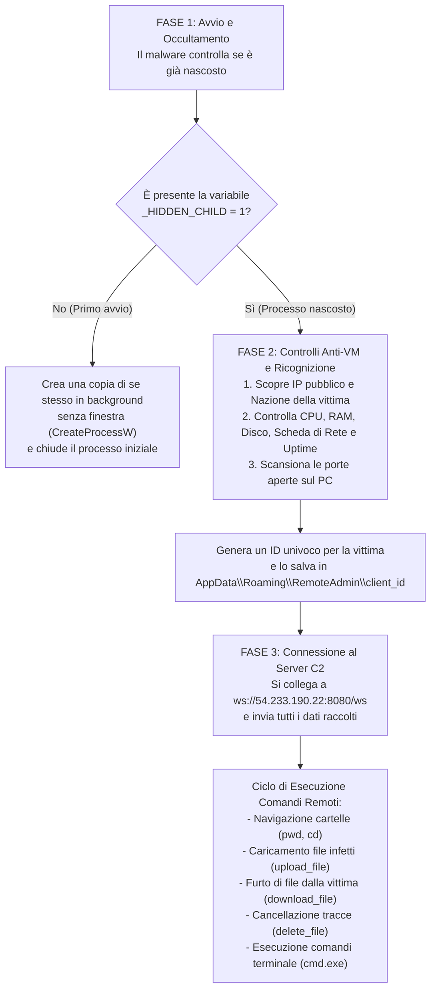

# Relazione Tecnica di Tirocinio: Analisi Comportamentale e Bypass delle Tecniche Anti-VM / Anti-Sandbox del Malware `TrickBot.exe` tramite Qiling Framework

**Attività di Tirocinio – Sicurezza Informatica e Malware Analysis**  
**Oggetto:** Studio del comportamento operativo di un Remote Access Trojan (RAT) scritto in Go e superamento delle tecniche di evasione tramite emulazione dinamica  
**Campione Analizzato:** `TrickBot.exe` (Eseguibile Windows a 64 bit, compilato in Go 1.23.4)  
**Strumento di Analisi:** Qiling Framework (Emulatore binario basato su Python)

---

## Introduzione e Metodologia di Analisi

La presente relazione illustra il lavoro di analisi svolto sull'eseguibile malevolo `TrickBot.exe`.  
A differenza dell'analisi tradizionale in macchina virtuale (dove il malware viene semplicemente avviato all'interno di un sistema operativo ospite), questo studio è stato condotto utilizzando **Qiling Framework**, un emulatore binario avanzato controllato tramite uno script Python ([TrickBot.py](file:///home/alberto-mancini/Documenti/Tirocinio/qiling/rootfs/x8664_windows/Windows/Documenti/TrickBot.py)).

In un emulatore come Qiling **non esiste un vero sistema operativo Windows in esecuzione**, né una scheda di rete reale o un processore fisico dedicato: Qiling carica il programma in memoria ed emula una per una le istruzioni del processore. Ogni volta che il malware richiede un servizio a Windows (ad esempio leggere l'ora, controllare quanta memoria RAM è presente o aprire una connessione Internet) invocando le cosiddette **API di Windows**, lo script Python può intercettare la richiesta (tramite una funzione detta *hook*), analizzarla e restituire al malware una risposta costruita ad hoc.

Questo approccio ha permesso di osservare il malware "dall'interno", individuando con precisione tutti i controlli che esso effettua per capire se si trova in un ambiente di analisi (**tecniche Anti-VM e Anti-Sandbox**) e costruendo le contromisure necessarie per ingannarlo fino ad estrarre tutti i suoi payload.

---

## 1. Comportamento Generale del Malware: Cosa Fa

Dall'analisi statica e dinamica è emerso che `TrickBot.exe` è un **RAT (Remote Access Trojan)** sviluppato in linguaggio **Go**. Una volta infettata la macchina vittima, il suo scopo è raccogliere informazioni dettagliate sul computer, inviarle a un server remoto controllato dall'attaccante (detto **Server di Comando e Controllo** o **C2**) e attendere ordini (come rubare file, scaricare altri virus o eseguire comandi nel terminale).

Il ciclo di vita del malware si divide in **tre fasi sequenziali**:



1. **Fase 1 – Auto-rilancio Nascosto (Occultamento):** Quando viene avviato per la prima volta, il malware non esegue subito le azioni dannose. Crea invece una seconda copia di se stesso completamente invisibile (senza finestra né icona) e termina immediatamente il primo processo.
2. **Fase 2 – Verifica dell'Ambiente (Anti-VM) e Profilazione della Vittima:** Il nuovo processo nascosto controlla le caratteristiche del computer (modello del processore, quantità di RAM, dimensione del disco, tempo di accensione, connessione a Internet). Questi dati servono sia per verificare di non trovarsi in una *sandbox* di sicurezza, sia per creare una "carta d'identità" completa del PC infetto.
3. **Fase 3 – Comunicazione con il Server C2 ed Esecuzione Comandi:** Il malware si connette al server dell'attaccante all'indirizzo `54.233.190.22` (porta `8080`) usando il protocollo **WebSocket** e invia i dati raccolti compressi nel formato binario **Google Protobuf**. Da quel momento rimane in ascolto per eseguire i comandi inviati dall'attaccante.

---

## 2. Tecniche Anti-VM e Anti-Sandbox Individuate e Come Sono State Aggirate

I moderni sistemi di sicurezza (detti *Sandbox*) analizzano i file sospetti eseguendoli per pochi minuti dentro una macchina virtuale (VM) isolata e osservando cosa fanno. Per difendersi, il malware integra diverse tecniche per accorgersi di essere analizzato o per far perdere le proprie tracce.  
Di seguito sono illustrate le **cinque tecniche principali** individuate durante lo studio, spiegando come funzionano, come sono state scoperte e come sono state neutralizzate nello script Python [TrickBot.py](file:///home/alberto-mancini/Documenti/Tirocinio/qiling/rootfs/x8664_windows/Windows/Documenti/TrickBot.py).

---

### 2.1 Evasione tramite Processo Figlio Nascosto (`_HIDDEN_CHILD`)

#### Come funziona e perché è una tecnica Anti-Sandbox
Molte sandbox e strumenti di analisi monitorano soltanto il programma principale che viene avviato all'inizio. Se quel programma termina subito, la sandbox conclude erroneamente che il file è innocuo e interrompe l'analisi.  
Per sfruttare questo limite, appena avviato il malware controlla se nel sistema esiste una variabile d'ambiente segreta chiamata `_HIDDEN_CHILD`:
- Al primo avvio questa variabile **non esiste**.
- Il malware allora chiama l'API di Windows `CreateProcessW` per lanciare una **nuova copia di se stesso** scollegata dal processo principale e senza finestra grafica, passando però a questa seconda copia la variabile `_HIDDEN_CHILD=1`.
- Subito dopo, il primo processo si chiude volontariamente (`os.Exit(0)`).

#### Come è stata individuata
Eseguendo inizialmente il malware in Qiling, si notava che il programma interrogava la variabile `_HIDDEN_CHILD` tramite l'API `GetEnvironmentVariableW`, chiamava `CreateProcessW` e poi terminava immediatamente senza stabilire alcuna connessione di rete.

#### Come è stata aggirata in Python
Poiché Qiling emula un singolo processo alla volta, se lasciassimo chiudere il processo padre perderemmo il controllo del malware. La soluzione implementata in [TrickBot.py](file:///home/alberto-mancini/Documenti/Tirocinio/qiling/rootfs/x8664_windows/Windows/Documenti/TrickBot.py) agisce in due passaggi:
1. Intercettiamo `CreateProcessW` per registrare il tentativo di avvio nascosto e salvare i parametri in [trickbot_payload_1.bin](file:///home/alberto-mancini/Documenti/Tirocinio/qiling/rootfs/x8664_windows/Windows/Documenti/trickbot_payload_1.bin).
2. Subito dopo `CreateProcessW`, all'indirizzo di memoria `0x77dd94` (dove il malware controlla se il processo figlio è stato creato per decidere se chiudersi), modifichiamo il registro del processore `RAX` impostandolo a `0`. In questo modo **impediamo al processo iniziale di chiudersi** e lo costringiamo a proseguire direttamente con il codice della Fase 2 come se fosse già il processo figlio.

```python
# 1. Intercettazione della creazione del processo nascosto
@winsdkapi(cc=STDCALL, params={
    'lpApplicationName': WSTRING, 'lpCommandLine': WSTRING,
    'lpProcessAttributes': POINTER, 'lpThreadAttributes': POINTER,
    'bInheritHandles': BOOL, 'dwCreationFlags': DWORD,
    'lpEnvironment': POINTER, 'lpCurrentDirectory': WSTRING,
    'lpStartupInfo': POINTER, 'lpProcessInformation': POINTER
})
def hook_CreateProcessW(ql, address, params):
    print(f"[!] STAGE 1 -> STAGE 2 SPAWN RILEVATO: {params['lpCommandLine']}")
    print(f"[!] Flags: {hex(params['dwCreationFlags'])} (Processo nascosto senza finestra)")
    # Segnaliamo allo script che il passaggio alla Fase 2 è avvenuto
    ql.hidden_child_spawned = True
    return 1  # Restituiamo successo al malware

# 2. Bypass della chiusura del processo iniziale (indirizzo 0x77dd94)
def hook_stage_transition(ql):
    if getattr(ql, 'hidden_child_spawned', False):
        print("[*] Bypass chiusura processo padre: proseguo direttamente nello Stage 2!")
        ql.arch.regs.rax = 0  # Impedisce la chiamata a os.Exit(0)
```

#### Output ottenuto
```text
[DEBUG/ENV] 🔍 GetEnvironmentVariableW('_HIDDEN_CHILD') -> Non impostato (Attivazione Stage 1 Dropper: setupHiddenProcess!)
!!!!!!!!!!!!!!!!!!!!!!!!!!!!!!!!!!!!!!!!!!!!!!!!!!!!!!!!!!!!!!!!!!!!!!
[!] 🚨 STAGE 1 -> STAGE 2 SPAWN RILEVATO: Chiamata a CreateProcessW
[!] Command Line : "C:\Windows\Documenti\Source\TrickBot\TrickBot.exe"
[!] Flags        : 0x8080408 (DETACHED_PROCESS=0x8 | CREATE_NO_WINDOW=0x8000000 | CREATE_UNICODE_ENVIRONMENT=0x400)
[!] Variabili Ambiente Figlio: ['COMPUTERNAME=DESKTOP-TRICKBOT', 'USERNAME=Admin', '_HIDDEN_CHILD=1']
!!!!!!!!!!!!!!!!!!!!!!!!!!!!!!!!!!!!!!!!!!!!!!!!!!!!!!!!!!!!!!!!!!!!!!
[*] 🔄 [STAGE TRANSITION @ 0x77dd94] Bypass os.Exit(0) del processo padre!
[*] 🚀 Transizione diretta in-process dallo Stage 1 (Dropper) allo Stage 2 (Hidden Child Payload _HIDDEN_CHILD=1)!
```

---

### 2.2 Controllo del Processore tramite Interrogazione WMI (`Win32_Processor`)

#### Come funziona e perché è una tecnica Anti-VM
Per capire se si trova dentro una macchina virtuale o un emulatore, il malware interroga il sottosistema di gestione di Windows (**WMI – Windows Management Instrumentation**) eseguendo la seguente query:
```sql
SELECT * FROM Win32_Processor
```
Su un computer reale, questa interrogazione restituisce il nome commerciale del processore (ad esempio `Intel Core i7...`), il produttore (`GenuineIntel`) e il numero di core fisici.  
In una macchina virtuale non configurata per nascondersi, restituisce invece nomi come `QEMU Virtual CPU`, `VMware` o `VirtualBox`. Inoltre, in un emulatore leggero come Qiling il servizio WMI non esiste affatto: se la richiesta fallisce, il malware va in crash e interrompe l'esecuzione.

#### Come è stata individuata
Monitorando le chiamate alle librerie di sistema `ole32.dll` e `oleaut32.dll` (usate da Windows per far comunicare i programmi con il servizio WMI), si è osservato che il malware cercava di aprire una connessione a `WbemScripting.SWbemLocator` e inviava la stringa `"SELECT * FROM Win32_Processor"`, bloccandosi subito dopo per l'assenza di una risposta valida.

#### Come è stata aggirata in Python
Nello script [TrickBot.py](file:///home/alberto-mancini/Documenti/Tirocinio/qiling/rootfs/x8664_windows/Windows/Documenti/TrickBot.py) abbiamo simulato il servizio WMI in memoria. Quando il malware esegue la query sul processore, lo script intercetta le richieste dei singoli campi e risponde fornendo le caratteristiche di un **vero processore desktop Intel Core i7-9700K a 8 core**:

```python
def hook_Invoke_trampoline(ql):
    # Intercetta le richieste WMI del malware e restituisce dati hardware realistici
    # ...
    if campo_richiesto == "Manufacturer":
        restituisci_stringa(ql, "GenuineIntel")
    elif campo_richiesto == "Name":
        restituisci_stringa(ql, "Intel(R) Core(TM) i7-9700K CPU @ 3.60GHz")
    elif campo_richiesto in ("NumberOfCores", "NumberOfLogicalProcessors"):
        restituisci_intero(ql, 8)      # 8 Core fisici e logici
    elif campo_richiesto == "MaxClockSpeed":
        restituisci_intero(ql, 3600)   # 3.60 GHz
    ql.arch.regs.rax = 0  # S_OK (Operazione riuscita)
```

#### Output ottenuto
```text
[DEBUG/COM] 🧩 CLSIDFromProgID chiamato per ProgID: 'WbemScripting.SWbemLocator'
[+] 🎯 WMI ExecQuery Argomento [0]: "SELECT * FROM Win32_Processor"
[+] IDispatch::Invoke: Restituito Manufacturer = 'GenuineIntel'
[+] IDispatch::Invoke: Restituito Name = 'Intel(R) Core(TM) i7-9700K CPU @ 3.60GHz'
[+] IDispatch::Invoke: Restituito NumberOfLogicalProcessors = 8
[+] IDispatch::Invoke: Restituito NumberOfCores = 8
[+] IDispatch::Invoke: Restituito MaxClockSpeed = 3600
```

---

### 2.3 Controlli basati sul Tempo: Uptime di Sistema, Pausa (`Sleep`) e Calcolo dell'Uso della CPU

#### Come funziona e perché è una tecnica Anti-Sandbox
Il malware utilizza il tempo in tre modi diversi per smascherare gli ambienti di analisi:
1. **Controllo dell'Uptime (`GetTickCount64`):** Verifica da quanti minuti è acceso il computer. Un PC usato da una persona reale è acceso spesso da decine di minuti o ore; una sandbox automatica viene invece accesa pochi secondi prima di lanciare il virus.
2. **Calcolo dell'utilizzo della CPU su un intervallo di 1 secondo:** Il malware legge i contatori di lavoro del processore (`NtQuerySystemInformation`), si mette in pausa per **1 secondo** (`time.Sleep`), e poi rilegge i contatori per calcolare la percentuale di utilizzo della CPU. Se i contatori restano fermi (come accade negli emulatori), la percentuale risulta `0%` o invalida.
3. **Orologio interno di Windows (`KUSER_SHARED_DATA`):** I programmi scritti in Go controllano lo scorrere del tempo leggendo un'area speciale della memoria di Windows chiamata `KUSER_SHARED_DATA` (all'indirizzo `0x7ffe0008`). In un emulatore, se quest'area di memoria non viene fatta avanzare artificialmente, il programma in pausa aspetta all'infinito che passi 1 secondo, generando un **loop infinito**.

#### Come è stata individuata
Durante i primi test in Qiling, il malware entrava in un loop infinito proprio mentre attendeva lo scadere della pausa di 1 secondo tra le due letture della CPU, poiché l'orologio in memoria rimaneva congelato.

#### Come è stata aggirata in Python
1. Abbiamo creato la funzione `update_kuser_time`, che **fa avanzare artificialmente l'orologio di sistema di Windows** ogni volta che il malware si mette in attesa, azzerando i tempi morti e risolvendo il loop infinito.
2. Abbiamo intercettato `GetTickCount64` per restituire un tempo di accensione simulato di **oltre 1 ora (3604 secondi)**.
3. Abbiamo intercettato `NtQuerySystemInformation` facendo aumentare i contatori di lavoro della CPU tra la prima e la seconda lettura, così da far calcolare al malware un utilizzo realistico del **24,69%**.

```python
# 1. Avanzamento artificiale dell'orologio di Windows per evitare loop infiniti sulle pause
def update_kuser_time(ql, increment_ms=1000):
    curr_time = struct.unpack('<Q', ql.mem.read(0x7ffe0008, 8))[0]
    curr_time += int(increment_ms) * 10000  # Avanza l'orologio di 'increment_ms' millisecondi
    ql.mem.write(0x7ffe0008, struct.pack('<Q', curr_time))
    ql.mem.write(0x7ffe0014, struct.pack('<Q', curr_time))

# 2. Simulazione di un PC acceso da oltre 1 ora (3.600.000 ms)
@winsdkapi(cc=STDCALL, params={})
def hook_GetTickCount64(ql, address, params):
    global tempo_simulato
    tempo_simulato += 250
    update_kuser_time(ql, 250)
    uptime_ms = 3600000 + tempo_simulato
    print(f"[DEBUG/SYSINFO] ⏱ GetTickCount64 -> Restituito uptime={uptime_ms // 1000} s")
    return uptime_ms

# 3. Simulazione di una CPU attiva ( ~24.69% di utilizzo tra i due campioni )
@winsdkapi(cc=STDCALL, params={
    'SystemInformationClass': ULONG, 'SystemInformation': POINTER,
    'SystemInformationLength': ULONG, 'ReturnLength': POINTER
})
def hook_NtQuerySystemInformation(ql, address, params):
    global nt_cpu_call_count
    if params['SystemInformationClass'] == 8:  # Richiesta statistiche CPU
        nt_cpu_call_count += 1
        # Ad ogni chiamata aumentiamo i contatori per simulare attività reale del processore
        idle_ticks   = 100000000 + nt_cpu_call_count * 7550000
        kernel_ticks = 150000000 + nt_cpu_call_count * 9000000
        user_ticks   = 30000000  + nt_cpu_call_count * 1000000
        entry = struct.pack('<qqqqqQ', idle_ticks, kernel_ticks, user_ticks, 2000000, 1000000, 5000)
        ql.mem.write(params['SystemInformation'], entry * 8)
        return 0
```

#### Output ottenuto
```text
[DEBUG/SYSINFO] 🖥️ NtQuerySystemInformation(SystemProcessorPerformanceInformation): Popolati 8 core (campione #1)
[DEBUG/IOCP] ⏱ GetQueuedCompletionStatusEx: Avanzato orologio KUSER_SHARED_DATA di +1000ms (Pausa 1s superata)
[DEBUG/SYSINFO] 🖥️ NtQuerySystemInformation(SystemProcessorPerformanceInformation): Popolati 8 core (campione #2)
[DEBUG/SYSINFO] ⏱ GetTickCount64 chiamato -> Restituito uptime=3604500 ms (3604 s)
```

---

### 2.4 Verifica delle Risorse Hardware (RAM, Disco Rigido, Scheda di Rete e Sistema Operativo)

#### Come funziona e perché è una tecnica Anti-VM
Le macchine virtuali usate per analizzare i virus vengono create risparmiando risorse: hanno spesso **poca memoria RAM** (es. 2 GB), **dischi rigidi piccoli** (es. 30–40 GB) e **schede di rete** con un traffico quasi pari a zero byte.  
Il malware ispeziona tutti questi parametri tramite specifiche chiamate di sistema:
- **`GlobalMemoryStatusEx`:** Controlla la memoria RAM totale e quella libera.
- **`GetLogicalDriveStringsW` e `GetDiskFreeSpaceExW`:** Controlla la dimensione totale e lo spazio libero del disco `C:\`.
- **`GetAdaptersAddresses` e `GetIfEntry2`:** Controlla il nome della scheda di rete, l'indirizzo fisico MAC e quanti Megabyte di dati sono stati inviati e ricevuti.
- **`RtlGetVersion` e Registro di Windows:** Controlla la versione esatta di Windows installata.

#### Come è stata individuata
Tracciando le API invocate durante la funzione `sysinfo.GetSystemInfo`, si è visto che il malware interrogava in sequenza memoria, dischi, interfacce di rete e chiavi di registro prima di tentare qualsiasi connessione verso l'esterno.

#### Come è stata aggirata in Python
Abbiamo intercettato ciascuna di queste API per presentare al malware il profilo di una **workstation reale e intensamente utilizzata**:
- **Memoria RAM:** `16 GB` totali (`6 GB` in uso, `10 GB` liberi).
- **Disco Rigido `C:\`:** Formattato in `NTFS`, da `500 GB` totali (`180 GB` occupati, `320 GB` liberi).
- **Scheda di Rete:** `Ethernet0` (`Intel Gigabit Network Connection`), IP `192.168.1.100`, con oltre **154 MB di dati ricevuti** e **48 MB inviati**.
- **Sistema Operativo:** `Windows 10 Pro (22H2, Build 19045)`.

```python
# Simulazione di 16 GB di RAM (6 GB usati, 10 GB liberi)
@winsdkapi(cc=STDCALL, params={'lpBuffer': POINTER})
def hook_GlobalMemoryStatusEx(ql, address, params):
    total_ram = 16 * (1024**3)  # 16 GB
    free_ram  = 10 * (1024**3)  # 10 GB
    # Scrive i valori nella struttura di memoria letta dal malware
    data = struct.pack('<IIQQQQQQQ', 64, 37, total_ram, free_ram, 32*(1024**3), 24*(1024**3), 0x7FFFFFFE0000, 0x7FFFFFF00000, 0)
    ql.mem.write(params['lpBuffer'], data)
    return 1

# Simulazione di un traffico di rete realistico sulla scheda Ethernet
@winsdkapi(cc=STDCALL, params={'pIfRow': POINTER})
def hook_GetIfEntry2(ql, address, params):
    p_row = params['pIfRow']
    if p_row:
        ql.mem.write(p_row + 0x4b8, struct.pack('<Q', 154829104))  # ~154.8 MB ricevuti
        ql.mem.write(p_row + 0x500, struct.pack('<Q', 48291042))   # ~48.2 MB inviati
    return 0
```

#### Output ottenuto
```text
[DEBUG/SYSINFO] 🧠 GlobalMemoryStatusEx: Total=16 GB, Used=6 GB, Free=10 GB
[DEBUG/SYSINFO] 💽 GetVolumeInformationW: Volume='Windows', FileSystem='NTFS'
[DEBUG/SYSINFO] 💽 GetDiskFreeSpaceExW: Total=500 GB, Used=180 GB, Free=320 GB
[+] GetAdaptersAddresses: Popolato adattatore virtuale 'Ethernet0' (IP: 192.168.1.100, MAC: 00:0C:29:12:34:56)
[DEBUG/SYSINFO] 🌐 GetIfEntry2: Popolati contatori traffico MIB_IF_ROW2 (InOctets=154.8 MB, OutOctets=48.2 MB)
[DEBUG/SYSINFO] 🪟 RtlGetVersion: Windows 10.0 Build 19045 (Workstation)
```

---

### 2.5 Verifica della Connettività Internet (IP Pubblico e Geolocalizzazione) e Scansione Porte

#### Come funziona e perché è una tecnica Anti-Sandbox
Molti ambienti di analisi isolano il malware dalla rete o non simulano correttamente i servizi web esterni. Prima di contattare il proprio server di comando, il malware effettua due controlli su Internet e una scansione locale:
1. Contatta il servizio legittimo **`api.ipify.org`** per scoprire il proprio indirizzo IP pubblico su Internet.
2. Contatta il servizio **`ip-api.com`** per scoprire in quale **Nazione** e **Città** si trova il computer infetto (alcuni malware evitano di attivarsi in determinate nazioni o se non rilevano una connessione valida).
3. Scansiona **23 porte di rete** sul computer locale (`127.0.0.1`) per scoprire quali servizi sono attivi sulla macchina (es. server web sulla porta `80`/`443` o Desktop Remoto sulla porta `3389`).

#### Come è stata individuata
Osservando le richieste DNS (`GetAddrInfoW`) e le connessioni di rete (`ConnectEx` e `WSASend`), si è visto che il malware cercava di risolvere i domini `api.ipify.org` e `ip-api.com`, e successivamente provava a collegarsi a raffica a 23 porte diverse su `127.0.0.1`.

#### Come è stata aggirata in Python
Nello script [TrickBot.py](file:///home/alberto-mancini/Documenti/Tirocinio/qiling/rootfs/x8664_windows/Windows/Documenti/TrickBot.py) abbiamo simulato l'intera rete Internet per il malware:
1. Quando il malware chiede di risolvere i nomi a dominio (`GetAddrInfoW`), gli forniamo degli indirizzi IP validi.
2. Quando invia la richiesta a `api.ipify.org` e a `ip-api.com` tramite l'API `WSASend`, intercettiamo i pacchetti e gli rispondiamo con due risposte HTTP JSON perfettamente formattate, facendogli credere di avere l'IP pubblico `198.51.100.42` situato a **New York (United States)**.
3. Durante la scansione delle 23 porte locali, rispondiamo che le porte `80`, `443`, `3389` e `8080` sono aperte, mentre per le altre restituiamo immediatamente "connessione rifiutata" così da non rallentare l'esecuzione.

```python
# Risposte HTTP simulate per i controlli Internet del malware
simulated_ipify_response = (
    b"HTTP/1.1 200 OK\r\nContent-Type: application/json\r\nContent-Length: 23\r\n\r\n"
    b'{"ip":"198.51.100.42"}'
)
simulated_ipapi_response = (
    b"HTTP/1.1 200 OK\r\nContent-Type: application/json\r\nContent-Length: 88\r\n\r\n"
    b'{"status":"success","country":"United States","city":"New York","query":"198.51.100.42"}'
)

# Intercettazione dell'invio dati sulla rete (WSASend)
if b"Host: api.ipify.org" in payload_inviato:
    print("[DEBUG/HTTP] 🌐 Intercettata richiesta IP pubblico a api.ipify.org")
    ql.recv_stream_buf = bytearray(simulated_ipify_response)

elif b"Host: ip-api.com" in payload_inviato:
    print("[DEBUG/HTTP] 🌍 Intercettata richiesta Geolocalizzazione a ip-api.com")
    ql.recv_stream_buf = bytearray(simulated_ipapi_response)
```

#### Output ottenuto
```text
[DEBUG/DNS] 🌐 GetAddrInfoW: Risolto 'api.ipify.org' -> 104.26.12.159:80
[DEBUG/HTTP] 🌐 WSASend -> Richiesta HTTP GET a api.ipify.org (99 bytes)
[DEBUG/DNS] 🌐 GetAddrInfoW: Risolto 'ip-api.com' -> 208.95.112.1:80
[DEBUG/HTTP] 🌍 WSASend -> Richiesta HTTP GET Geolocalizzazione a ip-api.com (104 bytes)
[DEBUG/RECON] 🔍 Scansione porta locale (sysinfo.isPortOpen): 127.0.0.1:80  -> APERTA
[DEBUG/RECON] 🔍 Scansione porta locale (sysinfo.isPortOpen): 127.0.0.1:443 -> APERTA
[DEBUG/RECON] 🔍 Scansione porta locale (sysinfo.isPortOpen): 127.0.0.1:3389 -> APERTA
[DEBUG/RECON] 🔍 Scansione porta locale (sysinfo.isPortOpen): 127.0.0.1:8080 -> APERTA
```

---

## 3. Simulazione del Server C2 ed Estrazione dei Payload Finali

Una volta superati tutti i controlli Anti-VM sopra descritti, il malware ritiene di trovarsi su un computer reale e passa alla fase operativa finale:
1. Genera un codice identificativo unico per la vittima (`client-DESKTOP-TRICKBOT-000c29-51616`) e lo salva nel file `AppData\Roaming\RemoteAdmin\client_id`.
2. Si collega al server di Comando e Controllo (C2) all'indirizzo **`ws://54.233.190.22:8080/ws`**.

Per scoprire tutto ciò che il malware è in grado di fare, all'interno dello script [TrickBot.py](file:///home/alberto-mancini/Documenti/Tirocinio/qiling/rootfs/x8664_windows/Windows/Documenti/TrickBot.py) **abbiamo simulato anche il Server C2 dell'attaccante**:
- Appena il malware si connette, ha inviato un primo pacchetto binario ([trickbot_payload_2.bin](file:///home/alberto-mancini/Documenti/Tirocinio/qiling/rootfs/x8664_windows/Windows/Documenti/trickbot_payload_2.bin)) contenente tutta la "scheda tecnica" del computer appena raccolta.
- Successivamente, il nostro server C2 simulato ha inviato al malware **4 comandi remoti consecutivi** per testarne tutte le funzionalità:
  1. **`pwd`**: richiesta della cartella di lavoro attuale del malware;
  2. **`upload_file`**: ordine di salvare sul disco della vittima (`C:\Windows\Temp\c2_dropped_module.bin`) un file eseguibile inviato dal server;
  3. **`download_file`**: ordine di rubare il file `client_id` dal disco della vittima e inviarlo al server;
  4. **`delete_file`**: ordine di cancellare il file precedentemente caricato per eliminare le tracce.
- Infine, il server simulato ha inviato il comando di chiusura della connessione (`Close 1001 Going Away`), permettendo al malware di chiudere la sessione in modo pulito e terminare autonomamente senza errori.

### 3.1 Tabella dei Payload Estratti durante l'Esecuzione

Durante l'analisi, lo script ha salvato automaticamente su disco tutti i pacchetti e i file scambiati dal malware:

| Nome File | Dimensione | Cosa contiene |
| :--- | :---: | :--- |
| [trickbot_payload_1.bin](file:///home/alberto-mancini/Documenti/Tirocinio/qiling/rootfs/x8664_windows/Windows/Documenti/trickbot_payload_1.bin) | `217 B` | I parametri usati nella Fase 1 per avviare il processo figlio nascosto (`_HIDDEN_CHILD=1`) |
| [trickbot_payload_2.bin](file:///home/alberto-mancini/Documenti/Tirocinio/qiling/rootfs/x8664_windows/Windows/Documenti/trickbot_payload_2.bin) | `412 B` | Il pacchetto iniziale inviato al server C2 con tutte le informazioni rubate sul PC vittima |
| [trickbot_payload_3.bin](file:///home/alberto-mancini/Documenti/Tirocinio/qiling/rootfs/x8664_windows/Windows/Documenti/trickbot_payload_3.bin) | `91 B` | La risposta del malware al comando `pwd` (`C:\Windows\Documenti\Source\TrickBot`) |
| [trickbot_payload_4.bin](file:///home/alberto-mancini/Documenti/Tirocinio/qiling/rootfs/x8664_windows/Windows/Documenti/trickbot_payload_4.bin) | `52 B` | Il file binario scaricato dal server C2 e scritto sul disco della vittima (`upload_file`) |
| [trickbot_payload_5.bin](file:///home/alberto-mancini/Documenti/Tirocinio/qiling/rootfs/x8664_windows/Windows/Documenti/trickbot_payload_5.bin) | `81 B` | La conferma inviata al server C2 dell'avvenuta scrittura del file (`"Successfully wrote file"`) |
| [trickbot_payload_6.bin](file:///home/alberto-mancini/Documenti/Tirocinio/qiling/rootfs/x8664_windows/Windows/Documenti/trickbot_payload_6.bin) | `120 B` | Il pacchetto contenente il file rubato dal PC della vittima tramite il comando `download_file` |
| [trickbot_payload_7.bin](file:///home/alberto-mancini/Documenti/Tirocinio/qiling/rootfs/x8664_windows/Windows/Documenti/trickbot_payload_7.bin) | `93 B` | La conferma inviata al server C2 dell'avvenuta cancellazione del file (`delete_file`) |

### 3.2 Il Report Finale Decodificato ([`trickbot_c2_full_report.json`](file:///home/alberto-mancini/Documenti/Tirocinio/qiling/rootfs/x8664_windows/Windows/Documenti/trickbot_c2_full_report.json))

Poiché i file `.bin` sopra elencati sono codificati in formato binario Protobuf, lo script li ha decodificati e riassunti automaticamente nel seguente file JSON leggibile, che mostra con esattezza tutti i dati esfiltrati dal malware e le risposte ai comandi:

```json
{
  "client_info": {
    "id": "client-DESKTOP-TRICKBOT-000c29-51616",
    "hostname": "DESKTOP-TRICKBOT",
    "os": "windows",
    "ip_address": "198.51.100.42",
    "country": "United States",
    "city": "New York",
    "system_info": {
      "cpu_cores": 1,
      "cpu_usage_percent": 24.69,
      "cpu_model": "Intel(R) Core(TM) i7-9700K CPU @ 3.60GHz",
      "total_memory_gb": 16.0,
      "used_memory_gb": 6.0,
      "free_memory_gb": 10.0,
      "disks": [
        {
          "device": "C:",
          "mount_point": "C:",
          "total_space_gb": 500.0,
          "used_space_gb": 180.0,
          "free_space_gb": 320.0,
          "filesystem_type": "NTFS"
        }
      ],
      "network_interfaces": [
        {
          "name": "Ethernet0",
          "ip_addresses": ["192.168.1.100/0"],
          "mac_address": "00:0c:29:12:34:56",
          "bytes_sent": 48291042,
          "bytes_received": 154829104
        }
      ],
      "os_version": "Microsoft Windows 10 Pro  10.0.19045.3803 Build 19045.3803",
      "kernel_version": "10.0.19045.3803 Build 19045.3803",
      "uptime_seconds": 3604,
      "open_ports": [80, 443, 3389, 8080]
    }
  },
  "c2_commands_responses": [
    {
      "id": "cmd-001-pwd",
      "output": "C:\\Windows\\Documenti\\Source\\TrickBot",
      "exit_code": 0,
      "completed": true
    },
    {
      "id": "cmd-002-upload",
      "output": "Successfully wrote file",
      "exit_code": 0,
      "completed": true
    },
    {
      "id": "cmd-003-download",
      "output": "Successfully read file",
      "exit_code": 0,
      "completed": true,
      "file_data_len": 36,
      "file_data_preview": "client-DESKTOP-TRICKBOT-000c29-51616"
    },
    {
      "id": "cmd-004-delete",
      "output": "Successfully deleted file/directory",
      "exit_code": 0,
      "completed": true
    }
  ]
}
```

---

## 4. Conclusioni

L'analisi svolta su `TrickBot.exe` tramite **Qiling Framework** ha permesso di ricostruire integralmente il funzionamento di un moderno trojan di accesso remoto scritto in Go, senza mai doverlo eseguire su un vero sistema Windows né esporre una rete reale.

Lo studio ha messo in evidenza come i malware attuali non si limitino a eseguire codice malevolo, ma verifichino prima in modo approfondito l'ambiente circostante: dall'auto-rilancio in background per sfuggire al monitoraggio iniziale, fino all'ispezione del modello di CPU tramite WMI, al controllo del tempo di accensione, della memoria RAM, della capienza del disco e della connettività Internet.  
Intercettando e simulando via software ciascuno di questi controlli all'interno dello script [TrickBot.py](file:///home/alberto-mancini/Documenti/Tirocinio/qiling/rootfs/x8664_windows/Windows/Documenti/TrickBot.py), è stato possibile eliminare ogni blocco o loop infinito, ingannare tutte le difese Anti-VM del malware ed estrarre con successo l'intero flusso di comunicazione con il server di Comando e Controllo.